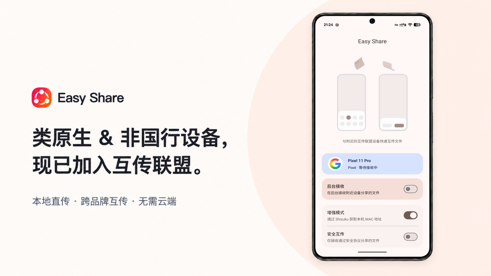

> **⚠️ 这是 [HotKids/EasyShare](https://github.com/HotKids/EasyShare) v1.0.4 的车机修改分支，不是官方发布版。**
> 目标场景：**比亚迪 DiLink 5.0 / Android 12 车机**，在没有 ADB / Shizuku 权限时，仍可作为发送端用互传联盟协议把文件发给另一台 EasyShare 设备。
>
> - 设置页新增 **「P2P MAC 地址（手动填写）」** 与 **「跳过 MAC 校验（EasyShare 互传）」**（默认开启）。
> - 开启时发送端不再抛 `Missing P2P device address`，也**完全不调用 Shizuku**；留空即用占位地址。
> - 接收端放宽对端 P2P MAC 校验 —— EasyShare ↔ EasyShare 互传本就不依赖该字段。
> - **仅当接收方是手机自带互传**（小米 / OPPO / vivo 原生实现，会校验 P2P 设备身份）时，才需关闭开关并填写车机真实 P2P Device Address。
>
> 改动明细：[`patches/EasyShare-car-changes.patch`](patches/EasyShare-car-changes.patch) ｜ 编译与安装：[`CAR-BUILD.md`](CAR-BUILD.md)
> 上游为 MIT 许可，原版权声明完整保留在 [`LICENSE`](LICENSE)。

---

# Easy Share

Easy Share 是一款兼容互传联盟协议的 Android 本地文件互传应用，可通过蓝牙发现附近的互传联盟设备，并使用 Wi‑Fi Direct 建立高速点对点连接。文件仅在设备之间直接传输，不依赖云端中转。

> Easy Share 基于 [kmod-midori/CatShare](https://github.com/kmod-midori/CatShare) 开发，并在 Codex 协助下完成全面重构。项目在保留互传联盟兼容能力的基础上，重新设计了界面、交互与传输流程，并增强了设备识别、传输稳定性与安全性。感谢 CatShare 原作者及所有贡献者。

## 功能

- 支持单文件、多文件和文本分享
- 兼容互传联盟 BLE/GATT 发现与协商流程
- 使用 Wi‑Fi Direct、HTTPS 和 WebSocket 完成点对点传输
- 支持接收确认、拒绝、取消、进度显示和结果通知
- 自动识别 Pixel、Samsung、Xiaomi、Redmi、OnePlus、OPPO、vivo、Meizu 等设备品牌
- 支持自定义设备名称、品牌和下载位置
- 提供“互传联盟”快速设置磁贴
- 发送前通过 Shizuku 获取本机 P2P MAC 地址
- 会话级 TLS 证书校验、随机令牌和安全传输元数据
- 针对 Android 16/17 及不同厂商 Wi‑Fi Direct 路由行为做了兼容处理

## 使用要求

- Android 12（API 31）或更高版本
- 发送和接收双方均需开启 Wi‑Fi 与蓝牙
- 发送文件前必须启动 Shizuku 并完成授权，用于获取本机 Wi‑Fi Direct MAC 地址；仅接收文件不依赖 Shizuku
- 默认接收目录为 `Downloads/Easy Share`

## 参与贡献

提交代码前请阅读 [贡献指南](CONTRIBUTING.md)。安全问题请按 [安全策略](SECURITY.md) 私下报告。

## 开源许可

本项目基于 MIT License 发布，并保留 CatShare 原项目的版权声明。详见 [LICENSE](LICENSE)。
